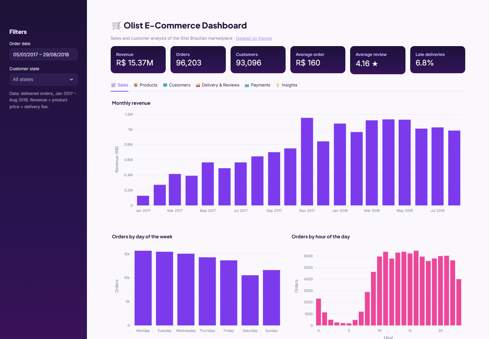
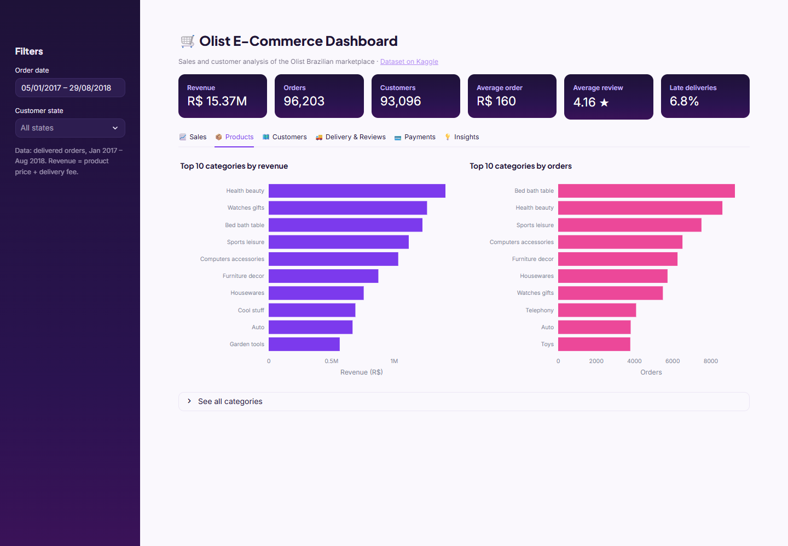
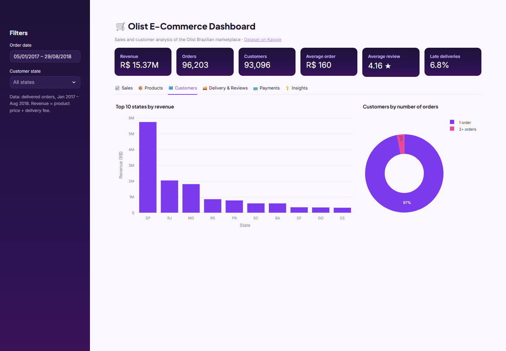
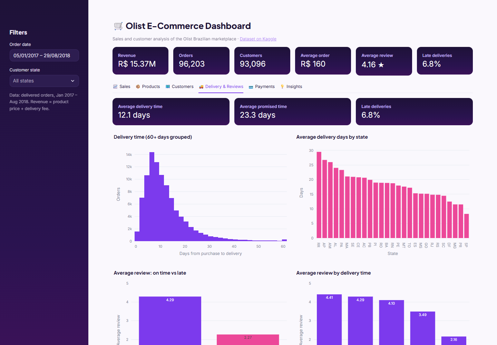
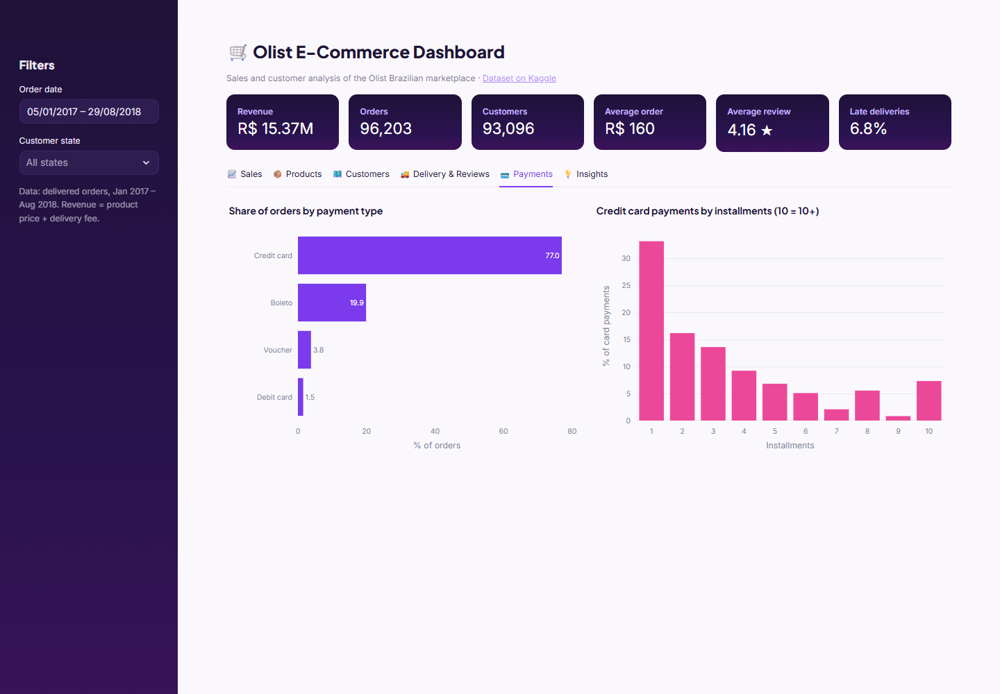
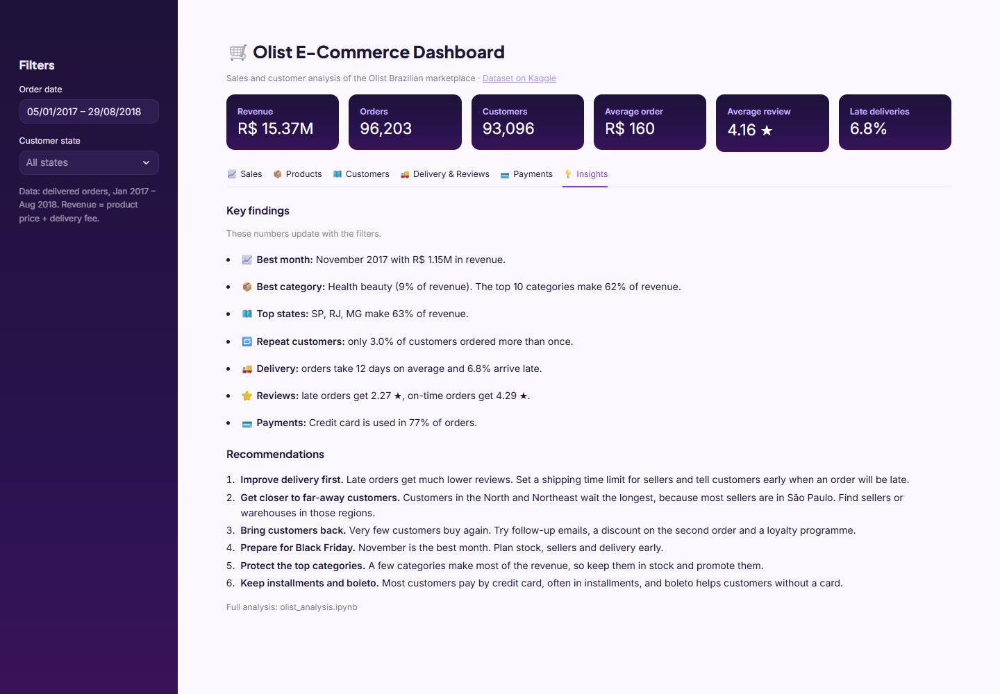

# Olist E-Commerce: Sales & Customer Analysis

A data analysis project using the [Brazilian E-Commerce Public Dataset by Olist](https://www.kaggle.com/datasets/olistbr/brazilian-ecommerce) from Kaggle (about 100,000 orders, 2016–2018).

- **`olist_analysis.ipynb`**: the analysis. It loads, explores and cleans the data, answers 7 business questions with charts, and ends with business insights and recommendations.
- **`app.py`**: an interactive Streamlit dashboard that shows the results, with filters for date and customer state.

**Tools:** Python, Pandas, Matplotlib, Plotly, Streamlit, Jupyter Notebook



## Business questions

1. How is the business doing overall?
2. How do sales change over time?
3. Which product categories sell the most?
4. Where are the customers, and do they come back?
5. How fast is delivery?
6. Does late delivery affect review scores?
7. How do customers pay?

## Key insights (delivered orders, Jan 2017 – Aug 2018)

- **R$ 15.37M revenue** from 96,203 orders and 93,096 customers. Average order: R$ 160.
- Revenue grew **143%** from 2017 to 2018 (Jan–Aug), but stayed flat during 2018. The best day was **Black Friday 2017**, with about 7 times a normal day's sales.
- **Health beauty** is the top category. The top 10 categories make **62%** of revenue.
- **São Paulo** makes 37% of revenue. Only **3%** of customers ordered more than once.
- Delivery takes **12 days** on average. Customers far from São Paulo wait 23–26 days.
- Late orders get **2.27 stars**, compared with **4.29** for on-time orders.
- **Credit card** is used in 77% of orders, often split into installments.

## Recommendations

1. Improve delivery first, because it has the biggest effect on reviews.
2. Find sellers or warehouses closer to customers in the North and Northeast.
3. Bring customers back with follow-up emails, second-order discounts and a loyalty programme.
4. Prepare stock and delivery capacity early for Black Friday.
5. Keep the top categories in stock and support the top sellers.
6. Keep offering installments and boleto (bank slip) payments.

## Project structure

```
├── olist_analysis.ipynb                 data analysis notebook
├── app.py                               Streamlit dashboard
├── data/                                clean data saved by the notebook, read by the dashboard
├── Olist Brazilian E-Commerce dataset/  raw CSV files from Kaggle
├── images/                              dashboard screenshots
├── .streamlit/config.toml               dashboard colours
└── requirements.txt
```

## How to run

```bash
python -m venv .venv
.venv\Scripts\activate          # macOS/Linux: source .venv/bin/activate
pip install -r requirements.txt

# 1. Open olist_analysis.ipynb in VS Code, choose the .venv kernel and click "Run All"
#    (this also saves the clean data to data/). To use Jupyter in the browser instead:
#    pip install notebook, then: jupyter notebook olist_analysis.ipynb

# 2. Start the dashboard
streamlit run app.py
```

The `data/` folder is already included, so you can start the dashboard without running the notebook first.

## Dashboard

| Sales | Products | Customers |
| --- | --- | --- |
|  |  |  |

| Delivery & Reviews | Payments | Insights |
| --- | --- | --- |
|  |  |  |
